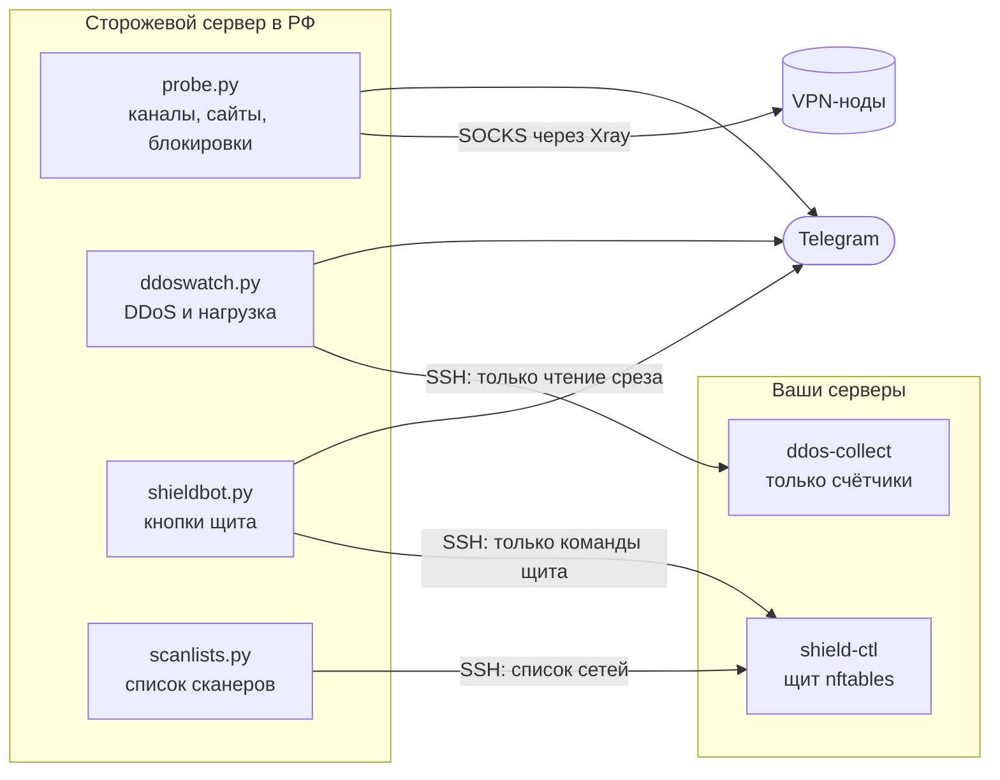

<div align="center">

# 🛡 Remnawave Watchdog

**Сторож для VPN-сервиса на Remnawave.**
Смотрит на ваш VPN глазами клиента из России и сообщает в Telegram, что сломалось, почему и чем это грозит.


[Что умеет](#-что-умеет) · [Как выглядит](#-как-это-выглядит-в-telegram) · [Установка](#-установка) · [Настройки](#%EF%B8%8F-настройки) · [Безопасность](#-безопасность)

</div>

---

Обычный мониторинг говорит «сервер жив». Клиенту от этого не легче, если провайдер душит канал, а подписка не
открывается. Сторож стоит **внутри российской сети** и каждые две минуты проходит тем же путём, что и ваши клиенты:
через каждую плитку подписки, к тем же сайтам и сервисам.

- 🇷🇺 **Взгляд изнутри РФ:** видит блокировки, замирание соединений (DPI) и подмену DNS, которых не видно из-за рубежа.
- 🧠 **Объясняет, а не только тревожит:** блокировка это или поломка ноды, атака или клиенты просто много качают.
- 🤝 **Ничего не делает сам:** блокировать адреса и резать трафик можно только кнопкой в Telegram.
- 🪶 **Лёгкий:** Python 3 и утилиты Ubuntu, без пакетов и баз; хватает 1 ядра и 1 ГБ памяти; входящих портов не открывает.

## ✨ Что умеет

### 📡 Каналы — раз в 2 минуты
Берёт служебную подписку Remnawave, поднимает локальный клиент Xray и проверяет **каждую плитку**:

| Проверка | Что видно |
|---|---|
| Жив ли канал | ✅ работает · 🔴 недоступен — с двумя попытками и подтверждением, без ложных тревог |
| Скорость | 🐢 медленно — по закачке, на которой соединение успевает разогнаться |
| Замирание | 🧊 душат — соединение есть, а данные встают (типичный DPI на 16–20 КБ) |
| Выход | 🔀 не тот выход — для каскадов сверяется ожидаемый адрес |
| Пинг и время соединения | рост против обычного для этого канала (медиана за полчаса против недели) |
| Сервисы через канал | Telegram, YouTube, Instagram, ChatGPT |

Если медленно сразу у всех каналов, сторож так и скажет: дело в его собственном сервере, а не в нодах.

### 🚧 Блокировки
- Когда канал лёг, сторож сам выясняет причину: пинг, порт, TLS, обрыв на 16–20 КБ, взгляд с других российских точек
  и из-за рубежа, трассировка.
- Раз в 6 часов сверяет ваши адреса и домены с публичными списками блокировок и показывает соседей в реестре.
- Проверяет, не подменяет ли обычный DNS адреса ваших сайтов и нод.
- Следит за страной и сетью адресов нод по пяти гео-базам: заметит, если «Германия» вдруг стала «США».

### 🌐 Сайты, подписка, сертификаты
- Панель, кабинет и другие ваши сайты — напрямую из РФ; страница подписки — **настоящей загрузкой** подписки.
- Сроки сертификатов и регистрации доменов: предупредит заранее и скажет, когда продлилось.
- Изменения в подписке: какие плитки появились, пропали или поменялись.

### 💥 DDoS и нагрузка — раз в минуту
- На каждом сервере работает лёгкий сборщик (5% CPU, 64 МБ): трафик и пакеты внешнего интерфейса, SYN-флуд,
  переполнение очередей, CPU, память, диск, swap, упавшие службы.
- **Пороги подстраиваются сами** под обычную нагрузку каждого сервера (p95 за неделю).
- VPN-нода, которая просто много качает клиентам, атакой **не считается**: сторож сравнивает входящий и исходящий трафик.
- Тип атаки (SYN-флуд, UDP, ICMP, объёмная, пакетная), уровень, протоколы и порты, на которые бьют.
- Контейнеры Docker: что упало, почему (по коду выхода), чем это грозит клиентам; перезапуски по кругу.

### 🛡 Щит от флуда — с кнопками в Telegram
- Своя таблица nftables, которая по умолчанию **только считает**, кто открывает слишком много новых соединений.
- При атаке или подозрительном адресе приходит **одно сообщение** с источниками и кнопками.
- Знает ваших клиентов (по журналу Xray) и помечает их: за одним адресом мобильного оператора сидят сотни людей.
- Блокировки и включённый щит **снимаются сами** по таймеру. Кнопка «Это не атака» поднимает порог сервера на неделю.
- Калитка: порты панели можно открыть только своим адресам.
- Команды в чате: `/shield` — что где заблокировано, `/unblock` — снять всё.

### 🔭 Сканеры
- Единый список сетей сканеров (публичные списки
  [shadow-netlab/traffic-guard-lists](https://github.com/shadow-netlab/traffic-guard-lists) плюс ваши добавки)
  раз в сутки расходится на все серверы.
- По умолчанию попадания **только считаются**; отбрасывать — отдельной командой, когда убедились, что ваших клиентов
  в списке нет. Ваши адреса и серверы вырезаются из списка всегда.

### 📊 Отчёты
- Полный отчёт три раза в день: каналы, сервисы, сайты, сертификаты, домены, подписка, серверы.
- Сводка за неделю по понедельникам: доступность, сбои, скорость и пинг по каналам.
- 🐕 **Сторож за сторожем** (`guard.py`) на другом сервере: если сам сторож упал или потерял связь — тоже придёт сообщение.

## 💬 Как это выглядит в Telegram

<table>
<tr><td>

🧊 **Душат: 🇩🇪 DE1**<br>
С 14:02 МСК соединение устанавливается, но данные встают: получено 18 КБ из 512 КБ.<br>
Вход с российских точек: обрыв на 16–20 КБ — похоже на блокировку, а не на поломку ноды.

</td><td>

✅ **Снова работает: 🇩🇪 DE1**<br>
Его душили 47 мин (14:02–14:49 МСК).

</td></tr>
<tr><td>

🚨 **Щит: nl1 — атака, можно отрезать источники**<br>
💥 Тип: SYN-флуд · 🔴 Уровень: высокий<br>
Больше всех сверх порога за 10 минут:<br>
❓ 203.0.113.7 — 41 000 лишних<br>
✅ наш клиент — 198.51.100.4<br>
<br>
`[ Заблокировать чужих на 1 ч ]`<br>
`[ Включить щит на 2 ч ]` `[ Это не атака ]`

</td><td>

🟡 **Состояние сервера требует внимания**<br>
🖥 Сервер: панель<br>
Контейнер remnawave-db упал: код 137 — убит из-за нехватки памяти или вручную.<br>
Чем грозит: панель не работает, новые подписки не выдаются.

</td></tr>
</table>

<sub>Примеры показывают формат сообщений; адреса условные.</sub>

## 🧩 Как устроено



Сторож сам ходит наружу. На серверах для него две строки в `authorized_keys`: обе только с адреса сторожа,
каждая умеет ровно одну команду.

## 🚀 Установка

**Нужно:** Remnawave (панель и ноды на Xray), сервер в России с Ubuntu 24.04/26.04, бот в Telegram.
В панели заведите служебного пользователя: все сквады, без срока и лимита трафика.

```bash
# 1. Каналы — на сторожевом сервере (спросит ссылку подписки и данные бота, пришлёт первый отчёт)
bash install.sh

# 2. Ваши сайты и домены
cp examples/site.example.json /etc/channel-watch/site.json && nano /etc/channel-watch/site.json

# 3. DDoS, щит, сканеры — в конце напечатает готовую команду для серверов
bash install_ddos.sh
```

```bash
# 4. На каждом сервере (рядом ddos_collect.py и shield_ctl.py) — команда из шага 3
bash server_install.sh --watch АДРЕС_СТОРОЖА --ddos-key '…' --shield-key '…' --allow 'ваши адреса'

# 5. Снова на стороже — подключить сервер
bash install_ddos.sh add nl1 203.0.113.10 22
```

По желанию: маячки на нодах (`beacon_install.sh`), точки проверки в других российских сетях (`vantage_install.sh`),
второй сторож (`guard_install.sh`).

Удалить: `bash install.sh --uninstall`, `bash install_ddos.sh --uninstall`, на серверах `bash server_install.sh --uninstall`.

## ⚙️ Настройки

<details>
<summary><b>Файлы настроек</b></summary>

| Файл | Что в нём |
|---|---|
| `/etc/channel-watch/sub.url` | ссылка служебной подписки (600) |
| `/etc/bridge-watch/guard.env` | `BW_TG_TOKEN`, `BW_TG_CHAT` — бот и чат (600) |
| `/etc/channel-watch/site.json` | ваши сайты, домены, исключения — образец в `examples/` |
| `/etc/channel-watch/ddos.json` | серверы под присмотром, рабочие часы, свои пороги (`thresholds`) |
| `/etc/channel-watch/owner.txt` | ваши адреса: никогда не блокируются и не считаются сканерами |
| `/etc/channel-watch/scanners-extra.txt`, `scanners-exclude.txt` | добавки и исключения к списку сканеров |
| `/etc/channel-watch/expected_exit.json` | ожидаемый выход для каскадов: `{"вход": "адрес выхода"}` |
| `/etc/channel-watch/nodes.json` | маячки нод (`beacon_install.sh`) |
| `/etc/channel-watch/vantage.json` | точки проверки (`probe.py --add-vantage`) |
| `/etc/storozh-shield/config.json` | на сервере: пороги щита (`rate`, `burst`, `conns`), свои адреса (`allow`), калитка портов |

</details>

<details>
<summary><b>Пороги</b></summary>

Значения в коде — разумная отправная точка, а не истина. Неделю посмотрите в режиме наблюдения (`/shield` в чате,
отчёты), потом подстройте под себя: пороги атак — в `ddos.json` → `thresholds`, щит — в `config.json` на сервере.

</details>

<details>
<summary><b>Ручные команды</b></summary>

```bash
python3 /opt/channel-watch/probe.py --show          # отчёт сейчас (без отправки)
python3 /opt/channel-watch/probe.py --blocks        # проверить блокировки сейчас
python3 /opt/channel-watch/probe.py --week          # сводка за неделю
python3 /opt/channel-watch/ddoswatch.py --status    # серверы и пороги
python3 /opt/channel-watch/shieldbot.py --status    # что заблокировано и где включён щит
python3 /opt/channel-watch/scanlists.py --dry       # скачать и проверить списки сканеров, никуда не слать
```

</details>

## 🔒 Безопасность

- **Ничего не блокирует сам.** Щит только считает; блокировка и резка — по нажатию, кнопки одноразовые и принимаются
  только из вашего чата.
- **Ключи с ограничениями.** На серверах ключ сторожа работает только с его адреса и умеет одну команду: прочитать срез
  или команду щита. Свои и частные адреса щит отказывается блокировать ещё раз, на самом сервере.
- **Чужие правила не трогает.** У щита своя таблица nftables; ufw, fail2ban, crowdsec и чужие таблицы остаются как
  были. Снимается одной командой.
- **Адреса не копит.** Сборщик держит только счётчики; «подозрительные» живут 5 минут, адреса ваших клиентов —
  сутки и только на самом сервере.

<details>
<summary><b>Куда сторож ходит</b></summary>

Только наружу и только туда, где это нужно для проверки: `api.telegram.org` (сообщения); через каналы — `gstatic.com`,
`speed.cloudflare.com`, `api.ipify.org`, Telegram, YouTube, Instagram, OpenAI (доступность сервисов); ваши сайты и
`rdap.org` (сроки доменов); `antifilter.download`/`antifilter.network` (списки блокировок); `dns.google`,
`cloudflare-dns.com` (сверка DNS); гео-базы `ipinfo.io`, `ip-api.com`, `ipwho.is`, `geojs.io`, `country.is`;
`raw.githubusercontent.com` (списки сканеров). Внешний сервис проверки нод (`external.json`) — заглушка, выключена и
запроса не содержит: адреса ваших нод никуда не уходят.

</details>

## 🧪 Тесты

Без сети и без root, на любой машине с Python 3.10+:

```bash
for t in test_*.py; do python3 $t | tail -1; done
```

## 📄 Лицензия

[MIT](LICENSE). Логика DDoS-части выросла из плагина ddos-monitoring к Remnawave (MIT).
